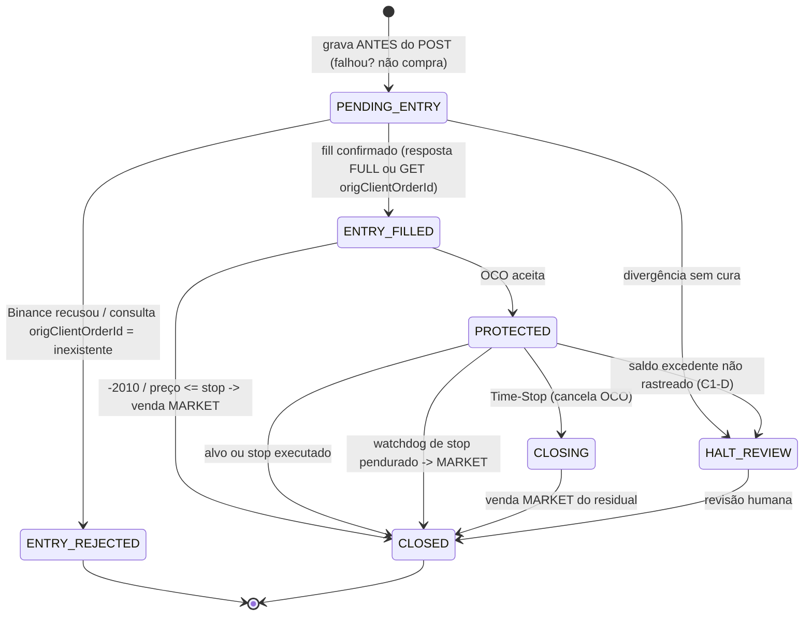

# Contrato de dados (SQLite v1)

Um **único arquivo SQLite** em modo WAL concentra todo o estado dos três modos
de operação. O schema inteiro é criado pelo `Database.migrate()` **já no
Bloco 1**, para que o contrato de dados fique congelado desde o início. Os
métodos de acesso (DAOs) de cada tabela são implementados nos blocos que as
consomem.

## 1. Regras gerais

| Regra | Motivo |
| --- | --- |
| Preços e quantidades **de ordens** são gravados como `TEXT` (`Decimal` serializado) | O `float` é proibido no envio de ordens (arquitetura §5.1) |
| Preços de **velas e análise** são gravados como `REAL` | Uso puramente estatístico; o `Decimal` só existe na fronteira com a API |
| Todos os horários são `INTEGER` em milissegundos UTC (`*_ms`) | Mesma unidade da Binance, sem ambiguidade de fuso |
| `close_time_ms` das velas é **normalizado** (`raw[6] + 1`, igual a `open_time + Δ`) | Item Cat. 1 do TODO (`merge_asof` exato) |
| Single-Slot garantido **pelo banco** via índice parcial único | Defesa em profundidade contra uma 2ª posição aberta |
| O JSON bruto do livro de ofertas **não** é gravado | C2-8: tamanho do banco e limite de 50 MB do backup via Telegram |

## 2. Uso das tabelas por modo

| Tabela | `ANALYST_ONLY` | `SHADOW_CHAMELEON` | `LIVE_CHAMELEON_PHASE_1` |
| --- | --- | --- | --- |
| `schema_meta`, `system_state`, `cycle_health`, `telegram_outbox` | ✅ | ✅ | ✅ |
| `candles`, `exchange_filters`, `regime_history` | ✅ | ✅ | ✅ |
| `virtual_signals`, `orderbook_snapshots`, `orderbook_walls` | ✅ | ✅ | ✅ |
| `shadow_trades` | — | ✅ | — |
| `trades`, `order_events` | — | — | ✅ |

## 3. Máquina de estados de `trades`



Os estados `PENDING_ENTRY`, `ENTRY_FILLED`, `PROTECTED`, `CLOSING` e
`HALT_REVIEW` contam como **slot ocupado** (índice `ux_trades_single_slot`).

## 4. Schema SQL completo

O DDL abaixo foi validado em SQLite 3.40, incluindo o índice parcial de
Single-Slot: a 2ª posição aberta é rejeitada com `UNIQUE constraint failed`.

```sql
-- ===================== PRAGMAs (aplicados a cada conexão) =====================
PRAGMA journal_mode = WAL;          -- validar retorno == 'wal'
PRAGMA synchronous = FULL;
PRAGMA foreign_keys = ON;
PRAGMA busy_timeout = 10000;
PRAGMA wal_autocheckpoint = 1000;

-- ===================== Metadados e estado =====================
CREATE TABLE IF NOT EXISTS schema_meta (
    key   TEXT PRIMARY KEY,
    value TEXT NOT NULL
) WITHOUT ROWID;

CREATE TABLE IF NOT EXISTS system_state (           -- HWM, pending_hodl_bucket_usdt, halt, fase...
    key           TEXT PRIMARY KEY,
    value         TEXT NOT NULL,                    -- Decimal serializado como str
    updated_at_ms INTEGER NOT NULL
) WITHOUT ROWID;

-- ===================== Dados de mercado =====================
CREATE TABLE IF NOT EXISTS candles (
    symbol                 TEXT    NOT NULL,
    interval               TEXT    NOT NULL CHECK (interval IN ('1m','1h','4h')),
    open_time_ms           INTEGER NOT NULL,
    close_time_ms          INTEGER NOT NULL,        -- NORMALIZADO: raw[6] + 1  (== open_time + duração)
    open                   REAL    NOT NULL,
    high                   REAL    NOT NULL,
    low                    REAL    NOT NULL,
    close                  REAL    NOT NULL,
    volume                 REAL    NOT NULL,        -- col 5
    quote_volume           REAL    NOT NULL,        -- col 7
    number_of_trades       INTEGER NOT NULL,        -- col 8
    taker_buy_base_volume  REAL    NOT NULL,        -- col 9
    taker_buy_quote_volume REAL    NOT NULL,        -- col 10
    ingested_at_ms         INTEGER NOT NULL,
    PRIMARY KEY (symbol, interval, open_time_ms),
    CHECK (close_time_ms > open_time_ms),
    CHECK (high >= low AND volume >= 0 AND taker_buy_base_volume <= volume + 1e-9)
) WITHOUT ROWID;
CREATE UNIQUE INDEX IF NOT EXISTS ux_candles_close ON candles(symbol, interval, close_time_ms);

CREATE TABLE IF NOT EXISTS exchange_filters (
    symbol        TEXT PRIMARY KEY,
    status        TEXT NOT NULL,
    base_asset    TEXT NOT NULL,
    quote_asset   TEXT NOT NULL,
    tick_size     TEXT NOT NULL,                    -- Decimal como TEXT (nunca REAL)
    step_size     TEXT NOT NULL,
    min_qty       TEXT NOT NULL,
    min_notional  TEXT NOT NULL,
    oco_allowed   INTEGER NOT NULL CHECK (oco_allowed IN (0,1)),
    fetched_at_ms INTEGER NOT NULL
) WITHOUT ROWID;

CREATE TABLE IF NOT EXISTS regime_history (
    symbol             TEXT    NOT NULL,
    close_time_4h_ms   INTEGER NOT NULL,
    regime             TEXT    NOT NULL CHECK (regime IN ('BEAR','BULL','SIDEWAYS','TRANSITION')),
    close_4h           REAL,
    ema100_4h          REAL,
    ema100_slope_4h    REAL,
    chop14_4h          REAL,
    adx14_4h           REAL,
    fallback_reason    TEXT,                        -- 'NAN' | 'WARMUP_LT_120' | NULL
    PRIMARY KEY (symbol, close_time_4h_ms)
) WITHOUT ROWID;

-- ===================== Radar: sinais virtuais e livro =====================
CREATE TABLE IF NOT EXISTS virtual_signals (
    signal_id             TEXT PRIMARY KEY,         -- 'SOL_20261114_2100'
    symbol                TEXT    NOT NULL,
    signal_close_time_ms  INTEGER NOT NULL,
    emitted_at_ms         INTEGER NOT NULL,
    setup                 TEXT    NOT NULL,         -- 'PINBAR' | 'ENGULFING' | 'SWEEP' | combinações
    regime_4h             TEXT    NOT NULL CHECK (regime_4h IN ('BEAR','BULL','SIDEWAYS','TRANSITION')),
    score_total           INTEGER NOT NULL CHECK (score_total BETWEEN 0 AND 100),
    score_l1              INTEGER NOT NULL, score_l2 INTEGER NOT NULL,
    score_l3              INTEGER NOT NULL, score_l4 INTEGER NOT NULL,
    grade                 TEXT    NOT NULL CHECK (grade IN ('B','A','A+')),
    entry_ref_price       REAL    NOT NULL,         -- ask do snapshot 0 (C2-2)
    candle_close_price    REAL    NOT NULL,
    stop_price            REAL    NOT NULL,
    target1_price         REAL    NOT NULL,
    target2_price         REAL    NOT NULL,
    atr14                 REAL    NOT NULL,
    horizon_end_ms        INTEGER NOT NULL,         -- por TEMPO (C2-7)
    cost_roundtrip_pct    REAL    NOT NULL,         -- modelo de custo único (C2-4)
    features_json         TEXT    NOT NULL,         -- ema_9/50/200, rvol, tbr, delta_quote, wick ratios
    ob_valid              INTEGER NOT NULL CHECK (ob_valid IN (0,1)),
    ob_band_eff_pct       REAL,
    ob_obi_mean           REAL,
    ob_bid_wall_price     REAL, ob_bid_wall_notional REAL,
    ob_ask_wall_price     REAL, ob_ask_wall_notional REAL,
    ob_ask_wall_before_t2 INTEGER CHECK (ob_ask_wall_before_t2 IN (0,1)),
    telegram_message_id   INTEGER,
    status                TEXT    NOT NULL DEFAULT 'OPEN'
                          CHECK (status IN ('OPEN','T1_THEN_T2','T1_THEN_STOP','T1_THEN_TIME','T2','STOP','TIME','INVALID_GAP')),
    same_candle_ambiguity INTEGER NOT NULL DEFAULT 0,
    resolved_at_ms        INTEGER,
    outcome_r_gross       REAL,
    outcome_r_net         REAL,
    mfe_r                 REAL,
    mae_r                 REAL,
    UNIQUE (symbol, signal_close_time_ms, setup)
);
CREATE INDEX IF NOT EXISTS ix_vs_open ON virtual_signals(status) WHERE status = 'OPEN';

CREATE TABLE IF NOT EXISTS orderbook_snapshots (
    snapshot_id       INTEGER PRIMARY KEY AUTOINCREMENT,
    signal_id         TEXT    NOT NULL REFERENCES virtual_signals(signal_id) ON DELETE CASCADE,
    seq               INTEGER NOT NULL CHECK (seq IN (0,1,2)),
    symbol            TEXT    NOT NULL,
    requested_limit   INTEGER NOT NULL,
    taken_at_ms       INTEGER NOT NULL,
    last_update_id    INTEGER NOT NULL,
    best_bid          REAL    NOT NULL,
    best_ask          REAL    NOT NULL,
    mid               REAL    NOT NULL,
    spread_bps        REAL    NOT NULL,
    bid_coverage_pct  REAL    NOT NULL,             -- C1-A
    ask_coverage_pct  REAL    NOT NULL,
    band_eff_pct      REAL    NOT NULL,             -- min(1.5%, cov_bid, cov_ask)
    bid_notional_band REAL    NOT NULL,
    ask_notional_band REAL    NOT NULL,
    obi               REAL,                         -- NULL se band_eff < 0.30%
    impact_bps_ref    REAL,                         -- custo de impacto da ordem de referência
    buckets_json      TEXT    NOT NULL,             -- faixas 0.1% ancoradas em mid_0 (C2-1, C2-8); ~1 KB
    UNIQUE (signal_id, seq)
);

CREATE TABLE IF NOT EXISTS orderbook_walls (
    signal_id         TEXT    NOT NULL REFERENCES virtual_signals(signal_id) ON DELETE CASCADE,
    side              TEXT    NOT NULL CHECK (side IN ('BID','ASK')),
    bucket_low        REAL    NOT NULL,
    bucket_high       REAL    NOT NULL,
    notional_mean     REAL    NOT NULL,
    median_multiple   REAL    NOT NULL,
    persistence       INTEGER NOT NULL CHECK (persistence BETWEEN 1 AND 3),
    PRIMARY KEY (signal_id, side, bucket_low)
) WITHOUT ROWID;

-- ===================== Chameleon: shadow e live =====================
CREATE TABLE IF NOT EXISTS shadow_trades (
    shadow_id             INTEGER PRIMARY KEY AUTOINCREMENT,
    symbol                TEXT    NOT NULL,
    strategy              TEXT    NOT NULL,
    regime                TEXT    NOT NULL,
    signal_close_time_ms  INTEGER NOT NULL,
    status                TEXT    NOT NULL CHECK (status IN ('OPEN','CLOSED')),
    decision_ask_price    REAL    NOT NULL,         -- bookTicker real no instante da decisão
    sim_entry_price       REAL    NOT NULL,         -- ask + slippage do modelo
    stop_price            REAL    NOT NULL,
    target_price          REAL    NOT NULL,
    qty                   TEXT    NOT NULL,
    risk_pct              REAL    NOT NULL,
    risk_usdt             TEXT    NOT NULL,
    virtual_equity_before TEXT    NOT NULL,
    time_barrier_end_ms   INTEGER NOT NULL,
    exit_reason           TEXT CHECK (exit_reason IN ('TARGET','STOP','TIME','SAME_CANDLE_STOP') OR exit_reason IS NULL),
    exit_price            REAL,
    r_gross               REAL,
    r_net                 REAL,
    ml_grade_silent       TEXT CHECK (ml_grade_silent IN ('A+','B','C') OR ml_grade_silent IS NULL),
    radar_signal_id       TEXT REFERENCES virtual_signals(signal_id),
    created_at_ms         INTEGER NOT NULL,
    closed_at_ms          INTEGER,
    UNIQUE (strategy, symbol, signal_close_time_ms)
);
CREATE UNIQUE INDEX IF NOT EXISTS ux_shadow_single_slot ON shadow_trades((1)) WHERE status = 'OPEN';

CREATE TABLE IF NOT EXISTS trades (
    trade_id               INTEGER PRIMARY KEY AUTOINCREMENT,
    client_order_id        TEXT    NOT NULL UNIQUE,  -- 'CHM_{symbol}_{epoch_ms}'
    environment            TEXT    NOT NULL CHECK (environment IN ('TESTNET','PRODUCTION')),
    symbol                 TEXT    NOT NULL,
    strategy               TEXT    NOT NULL,
    regime                 TEXT    NOT NULL,
    signal_close_time_ms   INTEGER NOT NULL,
    status                 TEXT    NOT NULL CHECK (status IN
                           ('PENDING_ENTRY','ENTRY_FILLED','PROTECTED','CLOSING','CLOSED','ENTRY_REJECTED','HALT_REVIEW')),
    planned_entry_price    TEXT    NOT NULL,
    planned_stop_price     TEXT    NOT NULL,
    planned_target_price   TEXT    NOT NULL,
    atr_at_signal          REAL    NOT NULL,
    risk_pct               REAL    NOT NULL,
    risk_usdt              TEXT    NOT NULL,
    quote_order_qty        TEXT,
    entry_order_id         INTEGER,
    entry_executed_qty     TEXT,
    entry_avg_price        TEXT,
    entry_quote_spent      TEXT,
    commission_base_asset  TEXT    NOT NULL DEFAULT '0',
    oco_order_list_id      INTEGER,
    oco_list_client_id     TEXT UNIQUE,
    oco_qty                TEXT,
    oco_stop_price         TEXT,
    oco_stop_limit_price   TEXT,
    oco_target_price       TEXT,
    time_barrier_end_ms    INTEGER NOT NULL,
    exit_reason            TEXT CHECK (exit_reason IN
                           ('TARGET','STOP','TIME','FALLBACK_MARKET_2010','STOP_WATCHDOG','RECONCILER') OR exit_reason IS NULL),
    exit_avg_price         TEXT,
    exit_quote_received    TEXT,
    fees_usdt_equiv        TEXT,
    realized_pnl_usdt      TEXT,
    realized_r             REAL,
    slippage_entry_bps     REAL,                     -- Gate 6B
    ml_grade_silent        TEXT CHECK (ml_grade_silent IN ('A+','B','C') OR ml_grade_silent IS NULL),
    ml_p_cal_silent        REAL,
    radar_signal_id        TEXT REFERENCES virtual_signals(signal_id),   -- anotação silenciosa (C1-C)
    created_at_ms          INTEGER NOT NULL,
    updated_at_ms          INTEGER NOT NULL,
    closed_at_ms           INTEGER
);
-- Single-Slot garantido PELO BANCO (testado em SQLite 3.40): 2ª posição aberta => UNIQUE constraint failed
CREATE UNIQUE INDEX IF NOT EXISTS ux_trades_single_slot ON trades((1))
    WHERE status IN ('PENDING_ENTRY','ENTRY_FILLED','PROTECTED','CLOSING','HALT_REVIEW');
CREATE INDEX IF NOT EXISTS ix_trades_created ON trades(created_at_ms);      -- max_daily_trades_cap

CREATE TABLE IF NOT EXISTS order_events (               -- trilha de auditoria de toda chamada assinada
    event_id        INTEGER PRIMARY KEY AUTOINCREMENT,
    trade_id        INTEGER REFERENCES trades(trade_id),
    client_order_id TEXT,
    method          TEXT    NOT NULL,
    endpoint        TEXT    NOT NULL,
    http_status     INTEGER,
    binance_code    INTEGER,                         -- -1007, -2010, -1021...
    request_json    TEXT    NOT NULL,                -- sem assinatura/API key
    response_json   TEXT,
    ts_ms           INTEGER NOT NULL
);

-- ===================== Observabilidade =====================
CREATE TABLE IF NOT EXISTS cycle_health (
    cycle_close_time_ms INTEGER PRIMARY KEY,
    mode                TEXT    NOT NULL,
    clock_offset_ms     REAL    NOT NULL,           -- Gate 6A: |offset| <= 500
    clock_rtt_ms        REAL    NOT NULL,
    used_weight_1m_peak INTEGER NOT NULL,
    stale_symbols       TEXT    NOT NULL DEFAULT '[]',
    gaps_detected       INTEGER NOT NULL DEFAULT 0,
    duration_ms         INTEGER NOT NULL,
    unhandled_errors    INTEGER NOT NULL DEFAULT 0
);

CREATE TABLE IF NOT EXISTS telegram_outbox (
    msg_id              INTEGER PRIMARY KEY AUTOINCREMENT,
    kind                TEXT    NOT NULL,            -- 'RADAR_CARD' | 'AUDIT_REPLY' | 'TRADE' | 'ALERT' | 'WEEKLY'
    payload             TEXT    NOT NULL,
    reply_to_signal_id  TEXT REFERENCES virtual_signals(signal_id),
    status              TEXT    NOT NULL DEFAULT 'PENDING' CHECK (status IN ('PENDING','SENT','FAILED')),
    attempts            INTEGER NOT NULL DEFAULT 0,
    telegram_message_id INTEGER,
    created_at_ms       INTEGER NOT NULL,
    sent_at_ms          INTEGER
);
```

## 5. Ciclo de vida de um sinal virtual (Radar)

| `status` | Significado |
| --- | --- |
| `OPEN` | Aguardando desfecho; avaliado a cada vela de 1h fechada a partir de t+1 |
| `T2` | Alvo final (+2,5R) atingido sem passar pelo stop |
| `T1_THEN_T2` / `T1_THEN_STOP` / `T1_THEN_TIME` | Alvo parcial atingido, seguido do desfecho indicado |
| `STOP` | Stop atingido (inclui empate intra-vela, em que o stop vence: `same_candle_ambiguity = 1`) |
| `TIME` | Horizonte de tempo esgotado; desfecho pelo `close` da última vela |
| `INVALID_GAP` | Lacuna de dados impediu a avaliação confiável |

O `outcome_r_net` desconta o **mesmo custo** usado pelo Chameleon (ADR-009), e
`mfe_r`/`mae_r` registram a excursão máxima favorável e adversa em unidades de R.
