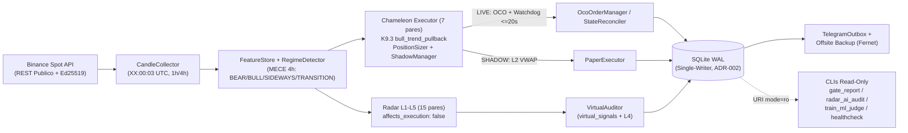

# QuantCrypto Chameleon & Radar Engine

Bot quantitativo Spot para a Binance (`1h`/`4h`, sem alavancagem) executado em **1 processo Python** e **1 banco SQLite (WAL)**, unificando dois subsistemas com fronteira rígida de responsabilidade:

* **Chameleon Engine (v6.0 — Braço Executor):** executa capital tático em 7 pares líquidos (`BTC`, `ETH`, `SOL`, `XRP`, `ADA`, `LINK`, `AVAX`; `BNBUSDT` estritamente proibido), com Single-Slot (`1` posição por vez), proteção OCO obrigatória, watchdog sub-horário, reconciliador de boot, teto duplo de risco (`1%` / `50%` caixa), CPPI (`-4%`) e Hard Stop (`-12%`).
* **Radar & Analyst Engine (v1.1 — Cérebro Analítico):** monitora 15 pares com funil de 5 camadas (EMA 9/50/200, Price Action, Order Flow e Order Book L2 anti-spoofing) + Auditor Virtual (`virtual_signals`). Na Fase 1 é **100% analítico** (`affects_execution: false`, ADR-004).

---

## Arquitetura em 30 Segundos

---

## Estado Atual do Projeto

| Dimensão | Situação verificada | Referência |
| --- | --- | --- |
| **Código implementado** | Blocos 1–6 + Backlog `B1`–`B7` + CI + Preflight | [Próximos Passos e Pré-mortem](next-steps.md) |
| **Suíte de testes** | `pytest`: **116 passed** (Gates 1–6, fault injection, `B1`–`B7`, `preflight`, paridade `AUD-01/05/06`) | [Guia Rápido](quickstart.md) |
| **Estratégia congelada** | `K9.3` (`bull_trend_pullback` em `config/strategies.yaml`, travada por SHA-256) | [Auditoria do Backtest e Edge](backtest-edge-audit.md) |
| **Etapa operacional** | Transição de **Gate 6A** (Testnet) → **Gate 6B** (Shadow Live) | [Metodologia e Roadmap](methodology-and-roadmap.md) |
| **Runtime** | Container único `mem_limit: 512m` (ADR-015) + `HEALTHCHECK` read-only | [Arquitetura Unificada](unified-architecture.md) |

!!! important "Nota da auditoria de backtest e paridade"
    Os bugs operacionais **AUD-01**, **AUD-05** e **AUD-06** (warmup 4h, deriva EMA100 e contexto BTC fail-closed) já foram corrigidos e testados. Consulte os achados estatísticos **AUD-02/AUD-03** na [Auditoria do Backtest e Edge (`K9.3`)](backtest-edge-audit.md) antes da decisão de capital na Fase 1.

---

## Mapa de Leitura por Perfil

### Operador (Deploy, Gates e Incidentes)
1. **[Guia Rápido e Transição de Gates](quickstart.md):** instalação, `preflight_check.py`, comandos de `6A`, `6B`, Fase 1 e Fase 2.
2. **[Runbook de Incidentes](runbook.md):** `HALT_REVIEW`, `EMERGENCY_HALT`, rotação de chaves Ed25519, reserva BNB, manutenção e mudança de API.
3. **[Backup e Restauração](backup-and-restore.md):** backup local rotacionado, backup offsite Fernet via Telegram e `restore_drill.sh`.

### Engenheiro (Arquitetura e Contrato de Dados)
1. **[Arquitetura Unificada (Canônica)](unified-architecture.md):** fronteira Chameleon/Radar, modos `.env`, processo único, SQLite WAL e `WeightGovernor`.
2. **[Contrato de Dados (SQLite WAL)](data-contract.md):** schema SQL v1, tabelas por modo e máquina de estados de `trades`.
3. **[Executor (Chameleon v6.0)](architecture.md)** e **[Radar & Auditor Virtual (v1.1)](radar.md):** especificação detalhada de cada subsistema.

### Auditor Quant & Governança
1. **[Metodologia e Roadmap](methodology-and-roadmap.md):** regras anti-overfitting, critérios `PASS`/`FAIL` dos gates e kill-switches.
2. **[Auditoria do Backtest e Edge (`K9.3`)](backtest-edge-audit.md):** revisão cética de causalidade, paridade produção × backtest, custos e sensibilidade do DSR.
3. **[Próximos Passos e Pré-mortem](next-steps.md):** backlog `B1`–`B10` e os 10 modos mais prováveis de perda de capital na Fase 1.
4. **[Decisões Arquiteturais (ADR)](decisions.md):** registro vinculante `ADR-001` a `ADR-015`.

!!! note "Aviso"
    Esta documentação é uma especificação técnica e operacional. Não constitui recomendação financeira e não autoriza operação com capital real sem aprovação explícita nos gates descritos na [Metodologia e Roadmap](methodology-and-roadmap.md).
