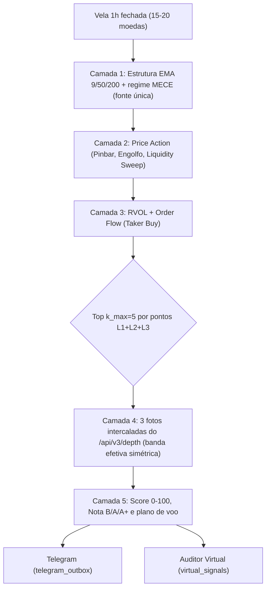

# Radar & Auditor Virtual (v1.1 integrado)

O **QuantCrypto Radar & Analyst Engine** é o cérebro analítico do sistema
unificado. Ele varre de 15 a 20 moedas a cada fechamento de vela de 1h, combina
**estrutura de médias (EMA 9/50/200)**, **Price Action**, **Order Flow**
(agressão compradora) e **leitura ao vivo do livro de ofertas**, envia um plano
de trade no Telegram e **audita automaticamente** cada alerta no SQLite.

Esta página é a especificação **v1.1**: o Radar v1.0 original
([repositório `quant-crypto-radar-engine`](https://github.com/pac-coins/quant-crypto-radar-engine))
com as emendas da [Auditoria de Integração](integration-audit.md) já aplicadas.

!!! danger "Fronteira inegociável"
    O Radar **nunca envia ordens**. Na Fase 1, a nota dele é apenas uma
    **anotação silenciosa** ligada ao trade do Chameleon (`trades.radar_signal_id`).
    Ver ADR-003 e ADR-004 em [Decisões](decisions.md).

---

## 1. O funil de 5 camadas



| Camada | Módulo | Pontos máximos | Fonte dos dados |
| --- | --- | --- | --- |
| 1. Estrutura | `radar/structure_ema.py` | 25 | `FeatureStore` + `regime_detector` |
| 2. Price Action | `features/price_action.py` | 25 | Velas fechadas |
| 3. Volume e Order Flow | `features/order_flow.py` | 25 | Colunas 5, 7, 9 e 10 do kline |
| 4. Livro de ofertas | `radar/orderbook_inspector.py` | 25 | `GET /api/v3/depth` ao vivo |
| 5. Score e plano | `radar/confluence_scorer.py` | — | Soma das camadas |

---

## 2. Especificação matemática

### Camada 1 — Estrutura de médias e clima

O clima **não** é recalculado pelo Radar: a Camada 1 lê o `regime` do
`regime_detector.py` (`BEAR` → `BULL` → `SIDEWAYS` → `TRANSITION`, ver
[Arquitetura do Executor §2.3](architecture.md)). A Camada 1 só pontua a
geometria de 1h:

1. **Alinhamento limpo (*Bullish Fanning*):**
   $\text{Close}_t > \text{EMA}_{9,t} > \text{EMA}_{50,t} > \text{EMA}_{200,t}$ e $\Delta\text{EMA}_{50,t} > 0$.
2. **Zona de valor (*Pullback Zone*):** $\text{EMA}_{50,t} > \text{EMA}_{200,t}$,
   $\lvert \text{Low}_t - \text{EMA}_{k,t} \rvert \le \text{tol} \cdot \text{ATR}_{14,t}$ para $k \in \{50, 200\}$,
   e fechamento acima da média tocada.
3. **Compressão (*Squeeze*):** $\dfrac{\max(\text{EMA}) - \min(\text{EMA})}{\text{ATR}_{14,t}} < 1{,}2$.

O parâmetro `max_chop_for_trend` vale apenas como critério de pontuação, nunca
como rótulo de clima (ADR-008).

### Camada 2 — Price Action

Com $R = H_t - L_t + \epsilon$ (tamanho da vela) e $B = \lvert C_t - O_t \rvert$ (corpo):

1. **Pinbar de rejeição:** $\dfrac{\min(O_t, C_t) - L_t}{R} \ge 0{,}55$,
   $\dfrac{H_t - \max(O_t, C_t)}{R} \le 0{,}18$ e $R \ge 0{,}75 \cdot \text{ATR}_{14,t}$.
2. **Engolfo de alta:** $C_{t-1} < O_{t-1}$, $C_t > O_t$, $C_t > O_{t-1}$,
   $O_t \le C_{t-1}$, $C_t > H_{t-1}$, $C_t > \text{EMA}_{9,t}$ e corpo $\ge 1{,}1 \cdot \text{ATR}_{14,t}$.
3. **Liquidity Sweep:** $L_t < \min_{j \in [t-20, t-1]} L_j$ e $C_t > \min_{j \in [t-20, t-1]} L_j$.
   É a **mesma função** `liquidity_sweep_bull` usada pelo Chameleon.

### Camada 3 — Volume relativo e Order Flow

$$\text{RVOL}_{20,t} = \frac{V_t}{\text{Mediana}(V_{t-19 \dots t})}, \qquad \text{TBR}_t = \frac{V_{\text{buy},t}}{V_t}, \qquad \Delta^{\text{USDT}}_t = 2\,Q_{\text{buy},t} - Q_t$$

onde $Q_t$ é o `quote_volume` (coluna 7) e $Q_{\text{buy},t}$ é o
`taker_buy_quote_volume` (coluna 10). Guardas de zero (C2-6): com $V_t = 0$,
$\text{TBR}_t = \text{NaN}$; com mediana igual a 0, $\text{RVOL} = \text{NaN}$
(nunca $\infty$).

### Camada 4 — Livro de ofertas com banda efetiva e anti-spoofing

Acionada **somente** para as até `k_max = 5` moedas com maior soma L1+L2+L3. São
3 fotos de `GET /api/v3/depth`, **intercaladas entre símbolos** (t₀, t₀+5 s,
t₀+10 s), com prioridade `LOW` no `WeightGovernor` e **sem retry**.

**Cobertura e banda efetiva (C1-A):**

$$\text{band}_{\text{eff}} = \min\left(1{,}5\%,\; \frac{P_{\text{best bid}} - P_{\min\text{ bid}}}{\text{mid}},\; \frac{P_{\max\text{ ask}} - P_{\text{best ask}}}{\text{mid}}\right)$$

**Desequilíbrio do livro:**

$$\text{OBI} = \frac{\sum_{\text{bids} \in \text{band}_{\text{eff}}} P Q - \sum_{\text{asks} \in \text{band}_{\text{eff}}} P Q}{\sum_{\text{bids} \in \text{band}_{\text{eff}}} P Q + \sum_{\text{asks} \in \text{band}_{\text{eff}}} P Q} \in [-1, +1]$$

* `obi_valid = band_eff ≥ 0,30%`. Se for inválido, a Camada 4 vale 0 pontos,
  não penaliza, e a nota máxima possível passa a ser **A**.
* O OBI final é a média das 3 fotos.

**Whale Walls:**

1. Faixas de 0,1% **ancoradas na grade absoluta da foto 0**: `bucket = floor(price / (mid₀ · 0,001))` (C2-1).
2. A faixa de borda parcialmente coberta é descartada.
3. Parede é a faixa com notional $\ge 4 \times$ a mediana das faixas, presente nas 3 fotos.
4. Uma *Ask Wall* antes de +2,5R rebaixa a nota e gera aviso no card.

**Custo de impacto:** spread efetivo e impacto (em bps) de uma ordem de referência.

**Persistência:** apenas os agregados e as faixas comprimidas (cerca de 1 KB
por foto) vão para `orderbook_snapshots`/`orderbook_walls`. O JSON bruto não é
gravado (C2-8).

### Camada 5 — Score, nota e plano de voo

| Score | Nota | Ação |
| --- | --- | --- |
| < 65 | — | Descartado silenciosamente |
| 65 a 74 | **B** | Card de monitoramento |
| 75 a 89 | **A** | Card de alta probabilidade |
| 90 a 100 | **A+** | Exige Camada 4 válida e sem *Ask Wall* até o alvo |

Plano sugerido: stop em 0,25·ATR abaixo do pavio ou da *Bid Wall* (distância
mínima de 1,2·ATR), alvos de +1,5R e +2,5R, horizonte de 24 h. Em modo LIVE,
cards sobre ativos da cesta do executor trazem o rodapé *"⚠️ Ativo gerido pelo
executor — não opere nesta conta"* (C1-D).

---

## 3. Auditor Virtual

O Auditor constrói o histórico proprietário de microestrutura que a Binance não
oferece de graça. Regras:

1. **Zero chamadas de API:** ele lê apenas as velas já coletadas no SQLite.
2. **Começa na vela t+1** (`open_time ≥ signal_close_time`). A entrada de
   referência é o **ask da foto 0**, não o `close` (C2-2).
3. **Pior caso intra-vela:** se stop e alvo caem na mesma vela, vale o stop
   (`same_candle_ambiguity = 1`).
4. **Horizonte por tempo** (`horizon_end_ms`), não por contagem de linhas.
   Lacunas de dados resultam em `INVALID_GAP` (C2-7).
5. **Custo único:** o `outcome_r_net` desconta o mesmo custo do Chameleon (ADR-009).
6. **Resolutor compartilhado:** `auditing/outcome_resolver.py` é o mesmo usado
   pelo `paper_executor` do modo Shadow (C2-3).
7. A resposta de resultado sai como *reply* do card original
   (`telegram_message_id`), e um placar semanal por setup e por nota é enviado
   aos domingos.

---

## 4. Configuração `config/analyst.yaml` (v1.1)

```yaml
version: "1.1.0"

scanner_universe:                           # Universo de ANÁLISE (pode conter BNBUSDT; nunca executado)
  macro_timeframe: "4h"
  trigger_timeframe: "1h"
  scan_delay_after_hour_seconds: 3
  symbols: ["BTCUSDT", "ETHUSDT", "SOLUSDT", "BNBUSDT", "XRPUSDT", "ADAUSDT", "LINKUSDT",
            "AVAXUSDT", "DOGEUSDT", "DOTUSDT", "SUIUSDT", "NEARUSDT", "APTUSDT", "ARBUSDT", "OPUSDT"]

layer_1_structure_ema:                      # Máx. 25 pontos; clima vem do regime_detector (ADR-008)
  ema_fast: 9
  ema_mid: 50
  ema_slow: 200
  chop_period: 14
  max_chop_for_trend: 52.0                  # Apenas pontuação
  pullback_touch_tolerance_atr: 0.45

layer_2_price_action:                       # Máx. 25 pontos
  min_candle_range_atr: 0.75
  pinbar_min_lower_wick_ratio: 0.55
  pinbar_max_upper_wick_ratio: 0.18
  engulfing_min_atr_mult: 1.10
  liquidity_sweep_lookback_candles: 20

layer_3_volume_and_order_flow:              # Máx. 25 pontos
  rvol_lookback: 20
  min_rvol_for_signal: 1.25
  high_conviction_rvol: 1.80
  min_taker_buy_ratio: 0.53
  strong_taker_buy_ratio: 0.57

layer_4_orderbook_live:                     # Máx. 25 pontos
  enabled: true
  affects_execution: false                  # TRAVA: Literal[False] no schema (ADR-004)
  depth_limit_default: 500
  depth_limit_overrides: {BTCUSDT: 1000, ETHUSDT: 1000}
  max_symbols_per_cycle: 5                  # k_max (ADR-005)
  anti_spoofing_snapshots: 3
  snapshot_interval_seconds: 5              # Fotos intercaladas entre símbolos
  imbalance_band_pct: 0.015                 # Teto; a banda real é band_eff (C1-A)
  min_valid_band_pct: 0.003                 # band_eff < 0.30% => Camada 4 inválida
  bullish_obi_threshold: 0.18
  bearish_obi_warning_threshold: -0.20
  whale_wall_multiplier: 4.0
  wall_bucket_pct: 0.001                    # Grade ancorada na foto 0 (C2-1)

layer_5_scoring_and_targets:
  min_score_to_alert_telegram: 65
  grade_b_min_score: 65
  grade_a_min_score: 75
  grade_a_plus_min_score: 90
  stop_buffer_below_wick_atr: 0.25
  min_stop_distance_atr: 1.2
  target_1_rr: 1.5
  target_2_rr: 2.5
  adjust_target_before_ask_wall: true
  time_horizon_hours: 24                    # Por tempo (C2-7)

virtual_auditor:
  track_all_alerts: true
  cost_model: "strategies.position_sizing"  # Custo único (ADR-009); substitui o fixo de 0.20%
  send_weekly_scorecard_telegram: true
```

---

## 5. Validação do Radar

| Camadas | Como validar | Onde |
| --- | --- | --- |
| 1, 2 e 3 | Backtest causal com velas históricas (incluindo as colunas 9 e 10) desde 2022-01-01, com o mesmo protocolo anti-ilusão do Bloco 3 (partição 60/25/15, `trials_registry.csv`) | `notebooks/04_radar_layers_123_backtest.ipynb` |
| 4 | **Não há backtest possível** (sem histórico gratuito de depth). Só existe o Auditor Virtual ao vivo, comparando o $\bar{R}$ de sinais com `obi_valid = 1` contra `obi_valid = 0` | `virtual_signals` |

!!! note "Ligar o Radar ao executor no futuro"
    Exigirá um gate próprio, ainda não especificado. No mínimo, deverá
    incluir amostra ao vivo suficiente no Auditor, ablação com e sem Camada 4,
    custo do Chameleon e compatibilidade com a OCO única do Single-Slot. Até
    lá vale o ADR-003.
