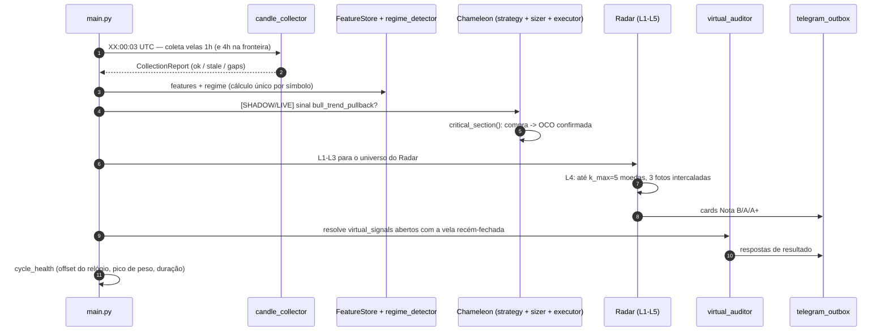

# Arquitetura unificada: Chameleon + Radar

Esta página consolida a decisão de unir, em **um único repositório e um único
processo**, os dois sistemas do ecossistema:

* **QuantCrypto Chameleon Engine (v6.0)** — o **Braço Executor**: motor Spot
  blindado (Single-Slot, OCO, Reconciliador de Boot, Teto Duplo de Risco e
  segregação via carteira `FUNDING`). Especificação em [Arquitetura do Executor](architecture.md).
* **QuantCrypto Radar & Analyst Engine (v1.1)** — o **Cérebro Analítico**:
  scanner multi-ativo (15 a 20 moedas) com funil de 5 camadas e Auditor
  Virtual no SQLite. Especificação em [Radar & Auditor](radar.md).

O repositório chama-se **`quant-crypto-chameleon-radar-engine`** (ADR-014).

!!! info "Convenção de rótulos usada nesta documentação"
    * **[FATO]** — fato da API Binance, do SQLite ou da matemática (verificável).
    * **[RISCO]** — risco de integração que só existe porque os dois sistemas foram unificados.
    * **[DECISÃO]** — decisão de arquitetura vinculante para a codificação (registrada em [Decisões (ADR)](decisions.md)).

---

## 1. Papéis e fronteiras

| Componente | Papel | Pode enviar ordens? | Depende de backtest aprovado? |
| --- | --- | --- | --- |
| Coletor + `FeatureStore` + `regime_detector` | Infraestrutura compartilhada | Não | Gate 1 e Gate 2 |
| Radar (Camadas 1 a 5) | Analista e copiloto no Telegram | **Nunca** | Camadas 1 a 3 têm notebook próprio; a Camada 4 só tem auditoria ao vivo |
| Auditor Virtual | Juiz de placar dos alertas | Nunca | Não (só mede) |
| `bull_trend_pullback` | Único emissor de sinal **executável** na Fase 1 | Via executor | **Gate 3** |
| `paper_executor` | Executor simulado (modo Shadow) | Não (simula) | Gate 3 |
| `oco_order_manager` + `state_reconciler` | Braço executor real | **Sim** | Gates 3, 4, 5 e 6 |

**[DECISÃO] Fronteira Radar → Executor (ADR-003):** na Fase 1 o executor
consome **somente** `StrategySignal` emitido por `bull_trend_pullback`. O score
do Radar entra como **anotação silenciosa** (`trades.radar_signal_id`), no mesmo
espírito do Juiz de IA em modo observador. A proposta original do Radar de
"conectar o `oco_order_manager.py` na saída do `confluence_scorer.py`" fica
**proibida** até que exista um gate próprio para isso, fora do escopo atual. Motivos:

1. o plano de voo do Radar (stop no pavio − 0,25·ATR, alvos parciais de +1,5R/+2,5R) não passou pelo Gate 3;
2. alvos parciais exigem duas OCOs, cada uma acima de 1,05 × `minNotional`, o que o reconciliador Single-Slot não modela;
3. o universo do Radar contém `BNBUSDT` e moedas fora do escopo do reconciliador (ver [C1-C](integration-audit.md#c1-c)).

**[DECISÃO] Livro de ofertas (ADR-004):** o item *"Ler Order Book Level 2 ao
vivo"* continua **descartado como gatilho de execução** (Categoria 3 do
[TODO](todo.md)). No sistema unificado, o livro existe **apenas** no caminho
analítico/auditor do Radar, com `affects_execution: Literal[False]` fixado no
schema Pydantic. Não é possível ligá-lo por YAML.

---

## 2. Os três modos de operação

O modo é escolhido pela variável `MODE` no `.env` e validado no boot por
`validate_mode_invariants()` (ver [Especificação do Bloco 1](block-1-spec.md)).

| Componente | `ANALYST_ONLY` | `SHADOW_CHAMELEON` | `LIVE_CHAMELEON_PHASE_1` |
| --- | --- | --- | --- |
| Chaves Binance | **Proibidas** (o boot falha se presentes) | **Proibidas** | **Obrigatórias** (Ed25519) |
| Host de market data | `data-api.binance.vision` | `data-api.binance.vision` | `api.binance.com` ou `testnet.binance.vision` (tudo do mesmo ambiente) |
| Coletor + FeatureStore + Regime | ✅ | ✅ | ✅ |
| Radar L1–L5 + Auditor + Telegram | ✅ | ✅ (anotação) | ✅ (anotação silenciosa) |
| `bull_trend_pullback` → sinais | ❌ | ✅ | ✅ |
| `position_sizer` / `shadow_manager` | ❌ | ✅ (carteira virtual `SHADOW_INITIAL_USDT`) | ✅ |
| `paper_executor` → `shadow_trades` | ❌ | ✅ | ❌ |
| `oco_order_manager` + `state_reconciler` → `trades` | ❌ (nem importados) | ❌ (nem importados) | ✅ |
| Trava de produção | — | — | `LIVE_CONFIRMATION=PHASE_1_GATES_6A_6B_PASSED` + SHA-256 do `strategies.yaml` aprovado |

Relação com o [roadmap](methodology-and-roadmap.md):

* `ANALYST_ONLY` pode entrar em produção assim que os Blocos 1 e 2 e os módulos
  do Radar passarem nos testes. Não arrisca capital.
* `SHADOW_CHAMELEON` é o veículo do **Gate 6B** (Shadow Live com dados reais).
* `LIVE_CHAMELEON_PHASE_1` com `BINANCE_ENV=TESTNET` é o veículo dos **Gates 5 e 6A**.
  Com `BINANCE_ENV=PRODUCTION`, é a **Fase 1**.

`.env.example` de referência:

```dotenv
MODE=ANALYST_ONLY                 # ANALYST_ONLY | SHADOW_CHAMELEON | LIVE_CHAMELEON_PHASE_1
BINANCE_ENV=TESTNET               # TESTNET | PRODUCTION (só lido em LIVE)
BINANCE_API_KEY=
BINANCE_ED25519_PRIVATE_KEY_PATH=
LIVE_CONFIRMATION=
APPROVED_STRATEGIES_SHA256=
SHADOW_INITIAL_USDT=300.00
TELEGRAM_BOT_TOKEN=
TELEGRAM_CHAT_ID=
DB_PATH=/app/data/quant.db
BACKUP_DIR=/app/data/backups
```

!!! warning "Permissões da API Key (apenas `LIVE_CHAMELEON_PHASE_1`)"
    * **Habilitar:** *Enable Reading*, *Enable Spot & Margin Trading* e
      *Permits Universal Transfer* (exigida na Fase 2 para
      `POST /sapi/v1/asset/transfer` `MAIN_FUNDING`; na Testnet é mockada).
    * **Proibir:** *Enable Withdrawals* (saque externo sempre desligado).
    * **Restringir:** chave **Ed25519** vinculada ao IP da VPS.

---

## 3. Processo único e orçamento de hardware

**[DECISÃO] (ADR-001 / ADR-015):** Radar e Chameleon rodam **no mesmo processo Python**,
com **uma thread de orquestração** e **uma conexão escritora** no SQLite, dentro de
um único container com **`mem_limit: 512m`** (`MemoryMax=512M` no systemd; originalmente
estimado em `100m` na ADR-001 e elevado pela ADR-015 após medição empírica abaixo).

**[FATO] RAM:** só os imports de `pandas` + `numpy` ocupam cerca de 40 a 60 MB
de RSS (estimativa típica em CPython 3.11/3.12). Dois containers duplicariam
esse custo e criariam dois escritores concorrentes no SQLite.

> **Medição empírica (ADR-015):** na VM real, `import src.main`
> (`pandas`, `numpy`, `pydantic`, `cryptography`, `requests`) já consome **93,4 MB**
> de RSS antes mesmo de carregar os DataFrames de 16 ativos. Por isso o teto foi
> elevado para **`mem_limit: 512m`** (`MemoryMax=512M` no systemd) para evitar
> `OOMKilled` (`Exit 137`).

---

## 4. Ciclo horário (ordem de execução)

**[DECISÃO] (ADR-006):** a execução do Chameleon é o **caminho crítico** e roda
**antes** da Camada 4 do Radar. As 3 fotos do livro de ofertas de todos os
símbolos selecionados são **intercaladas**: t₀ para todos, t₀+5 s para todos e
t₀+10 s para todos. Assim, a janela total fica em cerca de 10 s, seja qual for
a quantidade de moedas.



Moedas marcadas como `stale` (vela não virou após 5 tentativas de 1 s) são
**excluídas daquele ciclo**: não geram sinal e não derrubam o loop.

---

## 5. Contrato de concorrência do SQLite

**Veredito:** as tabelas `candles`, `trades`, `shadow_trades`,
`virtual_signals` e `orderbook_snapshots` coexistem no mesmo banco em WAL sem
`database is locked`, desde que se cumpram as regras abaixo.

**[FATO] Semântica do WAL:** leitores não bloqueiam o escritor, e o escritor
não bloqueia leitores. Existe **um único escritor por vez**: um segundo escritor
espera até `busy_timeout` e depois recebe `SQLITE_BUSY`.

**[FATO] Armadilha específica do WAL:** se uma transação *deferred* começa
lendo e depois tenta escrever, e outro escritor fez commit nesse intervalo, o
SQLite devolve `SQLITE_BUSY_SNAPSHOT` **na hora, ignorando o `busy_timeout`**.
A cura é abrir toda transação de escrita com `BEGIN IMMEDIATE`.

**[FATO] Carga estimada por ciclo horário (pior caso):**

| Escrita | Linhas | Transações |
| --- | --- | --- |
| Upsert de velas 1h + 4h (20 moedas) | ≤ 40 | 1 |
| Snapshots do livro (3 por sinal, teto k = 5) | ≤ 15 + agregados | ≤ 5 |
| `virtual_signals` (novos + resoluções) | ≤ 30 | 2 |
| `trades` / `shadow_trades` / `order_events` | ≤ 15 | ≤ 8 |
| `cycle_health` + `system_state` | ≤ 5 | 1 |

São cerca de 17 transações por hora. Com `synchronous=FULL`, cada commit custa
um `fsync` (de 2 a 20 ms em disco de VPS). Somando tudo, o lock de escrita fica
ocupado **menos de 1 segundo por hora**.

**[RISCO] As 4 causas reais de `database is locked` neste projeto:**

1. dois processos ou containers escrevendo no mesmo `.db`;
2. transação aberta durante I/O de rede (o modo legado do `sqlite3` do Python abre transação implícita no primeiro DML);
3. leitura que vira escrita sem `BEGIN IMMEDIATE`;
4. banco em sistema de arquivos sem memória compartilhada coerente (NFS, bind mounts do Docker Desktop no Windows/macOS).

**[DECISÃO] Regras do `database.py` (ADR-002):**

* `isolation_level=None`; escrita só via `with db.write_tx():`, que emite `BEGIN IMMEDIATE`;
* `PRAGMA journal_mode=WAL` (validar o retorno igual a `'wal'`), `synchronous=FULL`, `foreign_keys=ON`, `busy_timeout=10000`, `wal_autocheckpoint=1000`;
* **proibido I/O de rede dentro de `write_tx`**; o `write_tx` registra a thread dona e lança `WrongThreadError` se for chamado de outra thread;
* a escrita de `PENDING_ENTRY` **antes** do POST é obrigatória (se falhar, não compra). As escritas **depois** do fill são *best-effort* com retry e **nunca interrompem** a sequência compra → OCO (ver [C1-E](integration-audit.md#c1-e));
* backup via `sqlite3.backup()` com `pages=-1` (passo único). O arquivo gerado é **autocontido**: não precisa do `-wal`.

---

## 6. Orçamento de Rate Limit (`REQUEST_WEIGHT` = 6.000/min por IP)

**[FATO] Pesos oficiais vigentes (Spot REST):**

| Endpoint | Peso | Observação |
| --- | --- | --- |
| `GET /api/v3/klines` | **2** | Independe de `limit` (1–1000) |
| `GET /api/v3/depth` | **5 / 25 / 50 / 250** | `limit` 1–100 / 101–500 / 501–1000 / 1001–5000 |
| `GET /api/v3/exchangeInfo` | 20 | |
| `GET /api/v3/time` | 1 | |
| `GET /api/v3/ticker/bookTicker` (1 símbolo) | 2 | |
| `GET /api/v3/account` | 20 | |
| `GET /api/v3/account/commission` | 20 | |
| `GET /api/v3/order` | 4 | Consulta por `origClientOrderId` |
| `GET /api/v3/orderList` | 4 | |
| `GET /api/v3/openOrderList` | 6 | |
| `POST /api/v3/order` · `POST /api/v3/orderList/oco` · `DELETE /api/v3/orderList` | 1 cada | Também contam no limite `ORDERS` da conta |
| `/sapi/v1/system/status` | 1 | Pool SAPI separado, não soma nos 6.000 |

O limite é **por IP** e é compartilhado por todas as chamadas públicas e
assinadas. Acima dele a API responde HTTP 429 com `Retry-After`. Insistir depois
do 429 leva ao **HTTP 418** (ban de IP de 2 minutos a 3 dias).

**Cálculo no fechamento `XX:00:03 UTC`** (universo de 20 moedas, que já contém
as 7 do Chameleon e o BTC):

| Bloco de chamadas | Realista (hora comum, 2 sinais, 1 entrada) | Virada de 4h (realista) | Pior caso patológico |
| --- | --- | --- | --- |
| `time` | 1 | 1 | 1 |
| Klines 1h: 20 × 2 | 40 | 40 | 40 |
| Klines 4h: 20 × 2 | 0 | 40 | 40 |
| Retentativas de vela atrasada (5 × 20 × 2 × 2) | 0 | 0 | 400 |
| `exchangeInfo` (refresh horário) | 20 | 20 | 20 |
| Depth `limit=500`: k × 3 × 25 | 150 | 150 | 1.500 (k = 20) |
| Chameleon, caminho de entrada | 75 | 75 | 75 |
| Chameleon, Time-Stop no mesmo ciclo | 0 | 0 | 26 |
| Watchdog do stop | 0 | 0 | 4 |
| Backfill de boot coincidente | 0 | 0 | 80 |
| Auditor Virtual (lê do SQLite) | 0 | 0 | 0 |
| **Total** | **286 (4,8%)** | **326 (5,4%)** | **2.186 (36,4%)** |

O caminho de entrada soma 75: `account` 20 + `openOrderList` 6 + `bookTicker` 2
+ `POST order` 1 + `GET order` 4 + `account` 20 + `POST OCO` 1 + `commission` 20
+ fallback `MARKET` 1. O Time-Stop soma 26: `DELETE orderList` 1 + `GET orderList` 4
+ `account` 20 + `MARKET` 1.

**[DECISÃO] (ADR-005):**

1. **Teto de inspeção de livro:** no máximo `k_max = 5` moedas por ciclo,
   escolhidas pela maior soma de pontos L1+L2+L3. Com `limit=1000`, o pior caso
   do depth fica em 5 × 3 × 50 = 750.
2. `depth_limit` configurável por símbolo (padrão 500; BTC e ETH em 1000).
3. A fonte de verdade é o header `X-MBX-USED-WEIGHT-1M`, não a estimativa
   interna. Em VPS gratuita, o IP de saída pode ser compartilhado.
4. `WeightGovernor` com prioridades `CRITICAL > HIGH > LOW` e
   `critical_section()` entre o fill e a OCO confirmada (ver [C1-B](integration-audit.md#c1-b)).

---

## 7. Harmonização de indicadores (`EMA 20/100` × `EMA 9/50/200`)

**[DECISÃO] (ADR-007):** existe um único motor de cálculo, parametrizado por
período. Cada consumidor **declara** os indicadores de que precisa, e o
`FeatureStore` calcula a **união** uma única vez por
`(símbolo, timeframe, close_time)`.

```python
# src/features/feature_store.py
@dataclass(frozen=True)
class FeatureRequest:
    kind: Literal["ema", "atr", "adx", "rsi", "chop", "bb", "rvol", "tbr", "of_delta", "sweep"]
    period: int
    timeframe: Literal["1h", "4h"]
    extra: tuple[float, ...] = ()

    @property
    def column(self) -> str: ...   # "ema_20", "ema_100_4h", "chop_14_4h"

class FeatureConsumer(Protocol):
    def required_features(self) -> frozenset[FeatureRequest]: ...

class FeatureStore:
    def __init__(self, consumers: Sequence[FeatureConsumer]) -> None: ...
    def build(self, df_1h: pd.DataFrame, df_4h: pd.DataFrame) -> pd.DataFrame: ...
```

| Consumidor | Declara |
| --- | --- |
| `RegimeDetector` | `ema_100_4h`, `chop_14_4h`, `adx_14_4h` |
| `BullTrendPullback` | `ema_20`, `ema_100`, `atr_14` |
| `StructureEMA` (Radar L1) | `ema_9`, `ema_50`, `ema_200`, `atr_14` |
| `PriceAction` (Radar L2) | `atr_14`, `sweep_20` |
| `OrderFlow` (Radar L3) | `rvol_20`, `tbr`, `of_delta` |

Os módulos ficam em `indicators.py` (EMA/ATR/ADX/RSI/CHOP/BB/RVOL),
`order_flow.py` e `price_action.py`, todos com funções puras. O
`liquidity_sweep_bull` do TODO e o *Liquidity Sweep* do Radar são **a mesma
função**.

**[DECISÃO] Clima é fonte única (ADR-008):** a Camada 1 do Radar **não calcula
clima próprio**. Ela lê o `regime` do `regime_detector.py` (MECE, com
`CHOP < 50` para `BULL`). O limiar `max_chop_for_trend` do Radar vale só como
critério de **pontuação**.

**[DECISÃO] Dois YAMLs, um motor (ADR-009):** `config/strategies.yaml` fica
congelado pelo Gate 3, e o SHA-256 dele é verificado em LIVE/PRODUCTION.
`config/analyst.yaml` evolui livremente sem alterar esse hash. Os dois leem o
**mesmo modelo de custo** (`position_sizing.roundtrip_fee_assumption_pct` +
`stress_slippage_assumption_pct`).

---

## 8. Árvore de diretórios unificada

```text
quant-crypto-chameleon-radar-engine/
├── config/
│   ├── strategies.yaml                 # Chameleon v6.0 (CONGELADO pelo Gate 3; SHA-256 verificado em LIVE/PRODUCTION)
│   └── analyst.yaml                    # Radar v1.1 (universo 15–20, pesos, L4 com affects_execution: false)
├── notebooks/
│   ├── 01_download_causal_1h_4h_1m.ipynb
│   ├── 02_ablation_and_dsr_sim.ipynb
│   ├── 03_tail_stress_cppi_cusum.ipynb
│   └── 04_radar_layers_123_backtest.ipynb   # L1–L3 do Radar (L4 não tem histórico: só auditoria ao vivo)
├── logs/backtest_trials_registry.csv
├── models/                             # (Fase 2) modelo calibrado (Platt Scaling)
├── src/
│   ├── core/
│   │   ├── config.py                   # [B1] Pydantic: .env + 2 YAMLs, RunMode, invariantes por modo
│   │   ├── database.py                 # [B1] SQLite WAL single-writer, migrações, backup nativo
│   │   ├── binance_client.py           # [B1] Público/Assinado, WeightGovernor, relógio, Decimal, exchangeInfo, mock /sapi
│   │   └── state_reconciler.py         # [B5] Cura no boot (universo = execution_universe)
│   ├── data/
│   │   └── candle_collector.py         # [B1] XX:00:03, close_time+1ms, gaps, merge_asof backward
│   ├── features/
│   │   ├── indicators.py               # [B2] EMA/ATR/ADX/RSI/CHOP/BB/RVOL (funções puras)
│   │   ├── order_flow.py               # [B2] TBR, Delta (quote), absorção
│   │   ├── price_action.py             # [B2] Pinbar, Engolfo, Liquidity Sweep (compartilhado)
│   │   ├── feature_store.py            # [B2] União de FeatureRequest, cálculo único por ciclo
│   │   └── ml_judge.py                 # [B6] Observador silencioso (Fase 1)
│   ├── regimes/
│   │   └── regime_detector.py          # [B2] MECE: BEAR→BULL→SIDEWAYS→TRANSITION (fonte única de clima)
│   ├── strategies/
│   │   ├── base_strategy.py
│   │   ├── bull_trend_pullback.py      # Único emissor de StrategySignal executável na Fase 1
│   │   ├── sideways_pingpong.py
│   │   └── bear_capitulation_snap.py
│   ├── radar/
│   │   ├── structure_ema.py            # L1 (pontua; lê o regime do regime_detector)
│   │   ├── orderbook_inspector.py      # L4 (banda efetiva simétrica, grade ancorada, k_max)
│   │   └── confluence_scorer.py        # L5 (score 0–100, plano de voo)
│   ├── auditing/
│   │   ├── outcome_resolver.py         # Pior caso intra-vela + Time-Stop (compartilhado)
│   │   └── virtual_auditor.py          # Resolve virtual_signals a cada vela fechada
│   ├── risk/
│   │   ├── position_sizer.py
│   │   ├── shadow_manager.py           # Drawdown Scaling / Downgrade / Kill-switch
│   │   └── profit_splitter.py
│   ├── execution/
│   │   ├── executor_protocol.py        # Protocol Executor: submit(signal) -> TradeRef
│   │   ├── paper_executor.py           # SHADOW_CHAMELEON (sem chaves; usa bookTicker real)
│   │   └── oco_order_manager.py        # LIVE (entrada, OCO, -2010, watchdog, Time-Stop 4 passos)
│   ├── notifications/
│   │   └── telegram.py                 # Cards do Radar + relatórios do Chameleon via outbox
│   └── main.py                         # Orquestrador: monta os módulos conforme RunMode
├── tests/
│   ├── test_block1_causal_and_decimal.py
│   ├── test_block1_db_governor_modes.py
│   ├── test_block2_talib_and_mece.py
│   ├── test_block4_dual_cap_and_cppi.py
│   ├── test_block5_reconciler_and_oco.py
│   └── test_radar_orderbook_math.py
├── docs/                               # Esta documentação (MkDocs)
├── .env.example
├── Dockerfile                          # 1 processo, python:3.12-slim
├── docker-compose.yml                  # 1 serviço, mem_limit 512m (ADR-015), volume local para data/
├── requirements.txt
└── README.md
```

O contrato de dados completo (schema SQL) está em [Contrato de Dados](data-contract.md).
